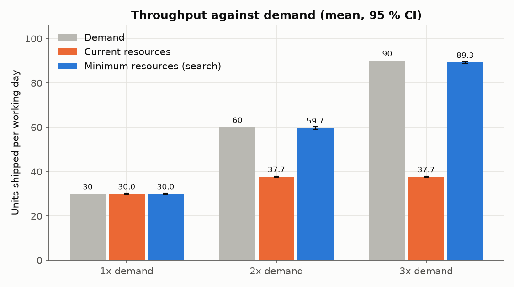
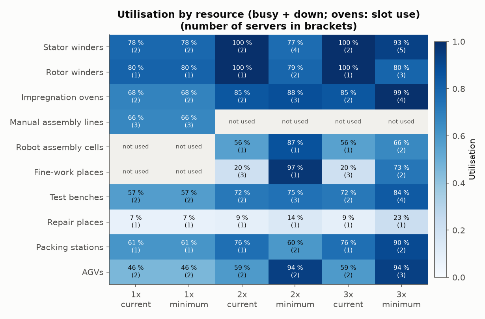
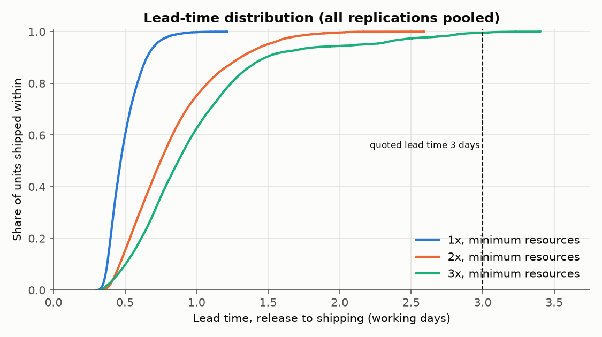
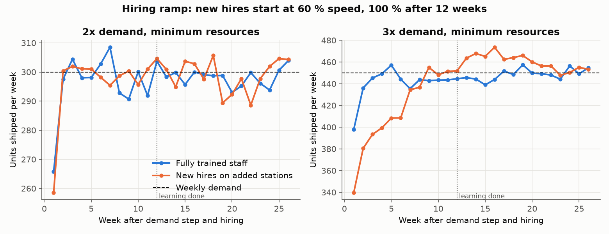

# Ramp-up simulation of an alternator plant

[](https://github.com/chad416/generator-plant-rampup-sim/actions/workflows/ci.yml)

A discrete-event model (Python, SimPy) of a mid-size plant building low-voltage synchronous alternators in three frame sizes. It asks what happens when demand goes to 2× and 3×:

- where the plant stops keeping up;
- the fewest winders, ovens, test benches, AGVs and other stations that still ship on time;
- how much output a hiring wave costs while new people learn the job.

**Every input is an assumption, not plant data.** The numbers in `config/base.yaml` are plausible round values, each with a comment. The results show how the plant behaves under *these* assumptions. See [Limits](#limits).



## The model

Each order is one alternator: small, medium or large frame. Daily order quantities are Poisson around 20 small, 6 medium and 4 large at 1× demand.

1. **Stator winding and rotor winding** run in parallel on separate winders, with times per frame.
2. **Impregnation** is a batch oven (VPI and cure). Each oven holds 12 slots; a small part takes 1 slot, a medium 2, a large 3. The cycle is fixed at 240 min. A batch starts when the oven is full, or when the oldest part has waited 60 min.
3. **Assembly** starts when both stator and rotor have arrived. Two modes:
   - *manual*: three manual lines (today);
   - *robot*: one robot cell (short cycle, low spread, 2 h maintenance every week) followed by manual fine-work places.
4. **Routine test** on test benches. Test times come from `data/test_times.json` (see [Interface](#interface-with-the-routine-test-station)). A frame change on a bench costs a changeover; a free bench that last tested the same frame is preferred. 2 % of units also get type-test steps.
5. Units that fail the test (first-pass yield 97 / 95 / 93 % by frame) go to **repair** and are re-tested.
6. **Packing**, then shipping.

**AGVs** move every part and unit between areas: 7 trips per unit, one load per trip. The nearest free AGV takes the oldest request and drives there empty, then loaded. Distances come from a matrix (40–260 m). An AGV charges for 60 min after 240 active minutes.

**Time:** 3 shifts × 7.5 h, 5 days a week. The clock counts working time only.

**Breakdowns:** every station type has an MTBF (in busy hours) and an MTTR. A failure stops a machine after the job in progress.

**People:** in a ramp run, the added stations are staffed by new hires, so a station going from 2 to 5 servers has 60 % new staff. A new hire works at 60 % speed on day one and at 100 % after 12 weeks (linear). Only the manual part of a job slows down: for example, bench handling slows but not the test sequence itself.

**Measurements:** 2 weeks of warm-up, then 20 weeks of measurement, 10 replications per configuration. A unit is **on time** if it ships within 3 working days of release. The **service level** is the on-time share of units released in the measurement window.

## Results

From `results/summary.md` (`python -m rampup plots`). ± is the 95 % confidence half-width over 10 replications.

| Scenario | Resources | Demand / day | Shipped / day | On time | Mean lead time (days) | Mean WIP | Bottleneck |
|---|---|---|---|---|---|---|---|
| 1× | current | 30 | 30.0 ± 0.3 | 100.0 % | 0.50 | 15 | rotor winding (80 %) |
| 2× | current | 60 | 37.7 ± 0.2 | 0.0 % | 22.4 (growing) | 1346 (growing) | rotor winding (100 %) |
| 2× | minimum | 60 | 59.7 ± 0.6 | 100.0 % | 0.82 | 49 | fine work (97 %) |
| 3× | current | 90 | 37.7 ± 0.2 | 0.0 % | 34.8 (growing) | 3126 (growing) | stator winding (100 %) |
| 3× | minimum | 90 | 89.3 ± 0.5 | 99.6 % ± 1.0 | 0.98 | 88 | impregnation (99 % of slots) |

"Current" at 2× and 3× means today's machines with the robot cell in place of the manual lines.

**Minimum resources** (smallest set whose lower 95 % CI bound of the on-time share is at least 95 %):

| Resource | Today | 1× | 2× | 3× |
|---|---|---|---|---|
| Stator winders | 2 | 2 | 4 | 5 |
| Rotor winders | 1 | 1 | 2 | 3 |
| Impregnation ovens (12 slots) | 2 | 2 | 3 | 4 |
| Manual assembly lines | 3 | 3 | – | – |
| Robot assembly cells | – | – | 1 | 2 |
| Fine-work places | – | – | 1 | 2 |
| Test benches | 2 | 2 | 3 | 4 |
| Repair places | 1 | 1 | 1 | 1 |
| Packing stations | 1 | 1 | 2 | 2 |
| AGVs | 2 | 2 | 2 | 3 |
| Direct operators, 3 shifts | 84 | 84 | 57 | 75 |

What the runs show:
- **Today's plant has no slack at the winders.** At 1× the rotor winder runs at 80 % and the stator winders at 78 %. Today's set is also the minimum at 1×: two manual lines or one AGV miss the target (on-time 97.0 % and 98.1 %, lower CI bounds 91.7 % and 94.2 %).
- **Winding caps output first.** With today's winders the plant ships 37.7 units a day whatever the demand. At 2× and 3× the queue and lead time grow without limit.
- **At 3× the ovens become the bottleneck.** Batches run 99 % full and parts wait longest for the oven. Four ovens just meet the target. In practice a fifth oven, or a larger one, is the first thing to add for margin.
- **One robot cell covers 2× but not 3×.** At 2× it runs at 87 %; at 3× the model needs a second cell.
- **AGV count stays small:** 2 at 2×, 3 at 3×. With 3 AGVs at 3×, each is busy or charging 94 % of the time. Charging takes 19 % of AGV time at 2× and 3× (9 % at 1×).
- **Fewer direct operators at 3× than today.** The model has 75 operators at 3× against 84 today, because the robot cell replaces 18 people per shift on the manual lines. This depends on the assumed 6 people per manual line, and counts only the modelled stations.
- **The minimum has almost no slack.** Several stations run at 93–99 %. The on-time target is met because 3 days is long compared with the 0.5–1 day lead time. The 3× lead-time p95 is 2.14 days, against 0.72 days at 1×.





### Hiring ramp

Demand steps to 2× or 3× at week 0, with the minimum resources in place. The added stations are staffed by new hires. The run is compared with the same plant fully trained (26 weeks, 10 replications):

| Scenario | Staff | Peak open orders (week) | Output ≥ 95 % of demand from week | Output lost to learning |
|---|---|---|---|---|
| 2× | fully trained | 60 (26) | 2 | – |
| 2× | new hires | 71 (24) | 2 | −12 units (noise) |
| 3× | fully trained | 135 (23) | 2 | – |
| 3× | new hires | 400 (8) | 7 | 116 units (1.3 days of demand) |

- **At 2× the learning curve costs nothing measurable.** The stations that get new hires (winders, test, packing) run at 60–80 % trained load, so a 20 % slowdown still fits.
- **At 3× it does cost output.** The stator winders run at 93 % with trained staff, and 60 % of their operators are new. For about six weeks the plant falls behind. Open orders peak at about 400 units, three times the trained level. At the end of the 26 weeks they are still 262, against 119 trained, because a station at 93 % has little spare capacity to catch up.
- **A ramp needs more than the steady-state minimum.** One extra stator winder during the ramp, or experienced operators moved onto the new machines, would avoid most of this.



### Checks

- **Little's law:** mean WIP against throughput × mean lead time is 14.9 against 14.9 units at 1× and 88.5 against 87.6 at 3×. The tests require agreement within 3 %.
- **Conservation:** units released = shipped + in the plant, in every test run, including the overloaded 2× run.
- **Analytic cases:**
  - a saturated deterministic station ships exactly 1 / service time;
  - an underloaded one is busy exactly arrival rate × service time;
  - an M/M/3 station at 80 % load has a mean wait inside the 95 % CI of 20 replications around the Erlang C value (1.079 min).
- **Observed first-pass yield:** 96.1 % against the 96.1 % expected from the inputs.
- **Runtime** on a 16-thread Windows PC with 12 worker processes:
  - full search: 13 s (`results/search_meta.json`); 128 s while another heavy job was running;
  - plots: 32 s;
  - the 32 tests: 15 s.

  A rerun of the search gives a byte-identical `search.json`.

## Interface with the routine-test station

A sister project, an automated routine-test station, will write `data/test_times.json`:

```json
{"source": "alternator-routine-test-station v0.1.0",
 "frames": {"small": {"routine_s": 1500, "type_test_extra_s": 400}, "medium": {...}, "large": {...}},
 "changeover_s": 600}
```

The file in this repository is a placeholder (`"source": "placeholder"`: 25 / 40 / 60 min routine test, 10 min changeover). Replace it and rerun `search` and `plots`. Every summary shows which source it used. A malformed file is rejected with an error.

## Run it

Python 3.12:

```bash
python -m venv .venv
.venv/bin/pip install -r requirements.txt      # Windows: .venv\Scripts\pip
python -m pytest -q                            # 32 tests
python -m rampup run --scenario 2x             # today's resources at 2x demand
python -m rampup run --scenario 3x --resources minimum
python -m rampup run --scenario 3x --resources minimum --set impregnation=5
python -m rampup search                        # minimum resources, writes results/search.json
python -m rampup plots                         # current vs minimum, ramp, PNGs, summary.md
```

`--quick` uses 3 replications and a 4-week window, and writes to `results/quick/` (CI uses it). `--config` points at another YAML file. Put your own scenario files in `config/private/`, which git ignores.

## How the search works

1. Start from a capacity lower bound: the fewest servers that keep each resource's load below 100 %. The bound ignores changeovers, empty AGV trips and repeat retests, so nothing below it can keep up. A test checks this for the test benches.
2. Evaluate the configuration (10 replications). If the lower 95 % CI bound of the on-time share is below 95 %, add one server to the resource with the highest utilisation, and repeat.
3. Try removing one server from each resource that is above its lower bound, least utilised first. Keep any removal that still meets the target. Repeat until no removal works.

The result is minimal one resource at a time: no single server can be removed. It is not proven to be the global minimum. Every evaluation is listed in `results/search.json`. All configurations use the same seeds, so they are compared on the same random demand.

## Limits

- **Assumed data.** Every time, MTBF, yield, distance and demand figure is an assumption. No plant data was used. The results show the method and the shape of the problem, not a capacity plan for a real plant.
- **Placeholder test times** until the routine-test station project supplies measured ones.
- **Working-time clock.** No weekend oven cure, no shift handover loss, no overtime, no absence.
- **Simplified AGV traffic.** No congestion, no blocked aisles, no traffic rules. Charging is time-based, and large frames ride on the same AGVs as small ones.
- **No material shortages.** Copper, laminations, housings and bearings are always available. The plant has no supplier limits and no finished-goods storage limit.
- **Breakdowns only stop a machine between jobs**, so long jobs never break mid-way. MTBF counts busy hours.
- **Learning is one straight line per station.** It is a share-weighted mix of new and trained staff, not a model of each person. Staff turnover during the ramp is not modelled.
- **The search sizes against the on-time target only.** It has no utilisation ceiling, so the minimum leaves several stations above 90 %. A real plan would add margin, as the hiring-ramp result shows.
- **Head count** covers only the modelled direct stations: no logistics, maintenance, quality or indirect staff.

## Layout

```
rampup/            model, resources (stations, batch oven, AGVs), search, report, CLI
tests/             pytest: queueing, oven, learning curve, whole plant, CLI
config/base.yaml   all assumptions, commented
config/private/    your own scenario files (git-ignored)
data/test_times.json   routine-test times (placeholder; interface with the test-station project)
results/           search.json, summary.json, summary.md and the plots above
SPEC.md            numbered requirements; docs/traceability.md maps them to tests
```

MIT licence.
